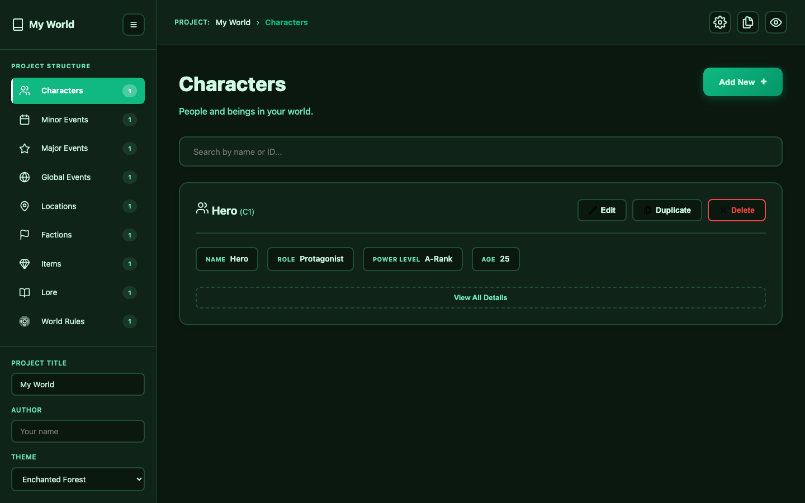

# World Builder

[](https://unknown-x0.github.io/World-Builder/)
[](https://github.com/UNKNOWN-X0/World-Builder/tags)
[](https://developer.mozilla.org/en-US/docs/Web/JavaScript)
[](LICENSE)

A browser-based worldbuilding workspace for writers and game masters. Organize characters, events, places, factions, items, lore, and world rules, link related entries, choose a genre theme, and keep your project in a portable JSON file.

**[Open World Builder →](https://unknown-x0.github.io/World-Builder/)**



## Features

- **Structured sections:** characters, events, locations, factions, items, lore, and world rules.
- **Linked entries:** link entries by ID and jump between related world elements.
- **Genre themes:** 15 themes, plus left-to-right or right-to-left text direction.
- **Editing tools:** search, filter, duplicate, and edit entries; undo deletions.
- **Portable data:** auto-save in the browser, and import or export a world as JSON.
- **Hosted imports:** load JSON from Google Drive share links or GitHub file links.
- **Multilingual text:** UTF-8 throughout.

## Getting started

### Use it online

Open the [live app](https://unknown-x0.github.io/World-Builder/). Export your world to JSON regularly to keep a backup or move it to another browser.

### Run it yourself

Download or clone the repository, then open `index.html` in a browser. No build step or package installation is required.

```sh
git clone https://github.com/UNKNOWN-X0/World-Builder.git
open World-Builder/index.html
```

## Usage

### Import and export

- **Export JSON** downloads the current world as a file.
- **Copy JSON** copies the data to the clipboard; **Preview** opens the JSON in a new tab.
- **Import** accepts a JSON file, a Google Drive share link, or a GitHub file link (converted to its raw URL). For a hosted file to be fetched, it must be accessible to your browser.

World data includes collections for characters, events, locations, factions, items, lore, and rules, plus project metadata such as title, author, language, and theme.

### Keyboard shortcuts

- `Ctrl`/`Cmd` + `S`: save or download the world as JSON
- `Escape`: close an open modal

## Privacy

World data is saved in local storage in the browser where you use the app. Imported files are fetched from the link you provide. Export JSON to back up your work; clearing browser storage can remove the local copy.

## Tests

```sh
node --test tests/*.test.cjs
```

The tests cover importing worlds from files and links, and the main editing functions.

## Project structure

```text
index.html             Page structure and module script loading
app.js                 Startup and application orchestration
data.js, schemas.js    Data model and component definitions
components.js, ui.js   Entry forms, rendering, and interface behavior
storage.js             Browser persistence and JSON import/export
themes.js, styles.css  Themes and visual styling
tests/                 Import and functionality regression tests
assets/preview.png     Screenshot for this README
```

## Project documents

| File | What it covers |
| --- | --- |
| [ROADMAP.md](ROADMAP.md) | What is planned next, with an issue per item |

## License

MIT. See [LICENSE](LICENSE).
